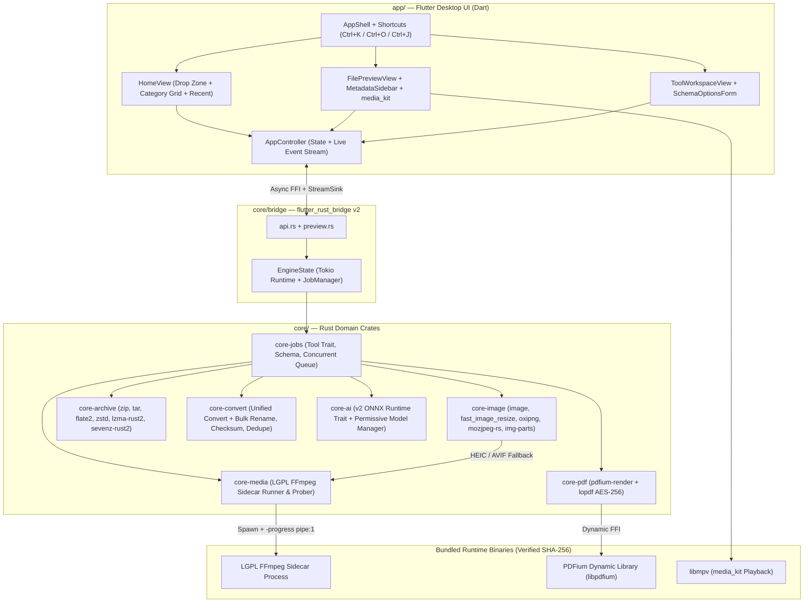

# Tool Center Architecture

Tool Center is structured as a strict two-layer monorepo separating presentation (**Flutter Desktop**) from computation and streaming I/O (**Rust Workspace**), connected over C FFI via `flutter_rust_bridge` v2.



---

## Monorepo Directory Layout

```text
tool-center/
├── app/                        # Flutter desktop UI (Windows, macOS, Linux)
│   ├── lib/l10n/               # Externalized ARB localization catalogs
│   ├── lib/src/models/         # Typed models for ToolDescriptor, JobSnapshot, Preview
│   ├── lib/src/rust/           # Auto-generated flutter_rust_bridge v2 bindings
│   ├── lib/src/services/       # FFI backend adapter & OS file reveal/open helpers
│   ├── lib/src/state/          # AppController reactive state
│   └── lib/src/ui/             # Light/dark themes, Home, Preview, SchemaOptionsForm
├── core/                       # Rust Cargo workspace
│   ├── core-jobs/              # Common `Tool` trait, OptionSchema, safe paths, JobManager
│   ├── core-image/             # Image preview, EXIF, SIMD resize, compress, watermark
│   ├── core-pdf/               # PDFium page rasterizer + lopdf structural/AES-256 tools
│   ├── core-media/             # LGPL FFmpeg sidecar locator, prober, progress/cancel runner
│   ├── core-archive/           # Streaming zip, tar.gz, 7z, zstd, xz + Zip-Slip protection
│   ├── core-convert/           # Convert category tools + Bulk Rename, Checksum, Dedupe
│   ├── core-ai/                # v2 ONNX Runtime interface + MIT/Apache model manager
│   └── bridge/                 # `cdylib`/`staticlib` FFI surface for Flutter
├── scripts/
│   ├── fetch_vendor.py         # Fetches & verifies SHA-256 + LGPL flags for FFmpeg & PDFium
│   ├── package_linux.sh        # Builds Linux .deb and AppImage artifacts
│   └── packaging/windows/      # Inno Setup Windows installer configuration
├── docs/
│   ├── ARCHITECTURE.md
│   └── LICENSES.md
└── .github/workflows/
    ├── ci.yml                  # Format, Clippy, Rust tests, Flutter analyze/test/build (3 OSes)
    └── release.yml             # Tagged matrix release packaging + SHA256SUMS + draft release
```

---

## Key Architectural Decisions

### 1. Declarative Schema-Driven Tool Architecture (`core-jobs`)
Every tool implements `core_jobs::Tool`:
- `descriptor(&self) -> ToolDescriptor`: declares accepted extensions, file count bounds, plain-language `OptionField` definitions (`Boolean`, `Integer`, `Number`, `Text`, `Select`, `PositionGrid`, `FilePath`), default values, and conditional `visible_when` rules.
- `validate(&self, inputs, options)`: validates files and parameters before queueing.
- `run(&self, ctx: &ToolContext)`: executes on a `tokio::task::spawn_blocking` thread bounded by `JobManager`'s concurrency `Semaphore`.

Because `SchemaOptionsForm` in Flutter renders controls directly from `options_schema`, adding new tools in Rust requires zero Flutter widget changes.

### 2. Concurrency, Progress Reporting & Instant Cancellation
- **UI Isolate Safety:** Synchronous FFI calls (`#[frb(sync)]`) are restricted to instantaneous in-memory reads (`list_tools_json`, `cancel_job`). All file inspection, preview rendering, and job execution are asynchronous off-isolate operations.
- **Zero-Polling Event Push:** `subscribe_job_events` uses a `flutter_rust_bridge` `StreamSink` backed by a `tokio::sync::broadcast` channel to push `JobSnapshot` transitions (`Queued` → `Running` → `Completed` / `Cancelled` / `Failed`) directly to Flutter.
- **Cooperative + Preemptive Cancellation:** `CancelHandle` pairs an `AtomicBool` (checked in streaming loops via `ctx.check_cancelled()?`) with registered `on_cancel` callbacks. When `core-media` spawns an `ffmpeg` child process, it registers a kill hook so clicking **Cancel** terminates the OS child process immediately.

### 3. Streaming & Low-Memory Design
- **Archives (`core-archive`):** All compression and extraction flows stream through `64 KiB` stack buffers.
- **Checksums & Duplicate Finder (`core-convert`):** Checksums stream in `64 KiB` chunks; Duplicate Finder eliminates unique file sizes with zero disk reads, then checks an `8 KiB` head+tail BLAKE3 pre-hash before streaming full-file BLAKE3 only on true collisions.
- **Text / CSV / JSON Preview (`bridge/src/preview.rs`):** Reads at most `256 KiB` (`File::take`) and trims cleanly on UTF-8 codepoint boundaries so multi-gigabyte logs or CSVs preview instantaneously.
- **PDF Preview (`core-pdf`):** Rasterizes only the single currently viewed page on demand via `pdfium-render` (cached behind a thread-safe `OnceLock<Pdfium>` singleton).

### 4. Non-Destructive File Safety
`resolve_safe_output_path` and `resolve_safe_output_dir` guarantee that Tool Center **never overwrites an input file or any pre-existing file on disk**, automatically appending `_2`, `_3`, etc. on collision. Archive extraction additionally enforces `sanitize_entry_rel_path` to block Zip-Slip (`../`) attacks.

### 5. v2 AI Foundation (`core-ai`)
`core-ai` defines the `OnnxRuntimeEngine` and `OnnxInferenceSession` traits alongside `ModelManager`:
- Models are **never bundled** in the installer; they download on demand into the user's application support cache directory (`ai_models/`), streaming to `.onnx.part` and verifying SHA-256 before atomic rename.
- `validate_permissive_model_license` programmatically enforces that only `MIT`, `Apache-2.0`, `BSD`, or `ISC` models can be loaded or downloaded, explicitly flagging and rejecting non-commercial (`CC-BY-NC*`, `RMBG-1.4`) or copyleft models.
