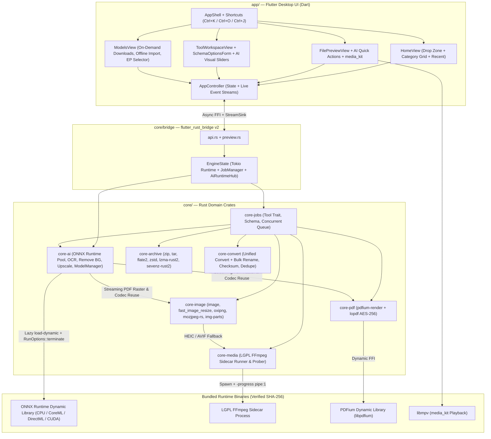

# Tool Center Architecture

Tool Center is structured as a strict two-layer monorepo separating presentation (**Flutter Desktop**) from computation, AI inference, and streaming I/O (**Rust Workspace**), connected over C FFI via `flutter_rust_bridge` v2.



---

## Monorepo Directory Layout

```text
tool-center/
├── models.json                 # Versioned v2 AI model manifest (sizes, URLs, SHA-256, SPDX licenses)
├── app/                        # Flutter desktop UI (Windows, macOS, Linux)
│   ├── lib/l10n/               # Externalized ARB localization catalogs
│   ├── lib/src/models/         # Typed models for ToolDescriptor, JobSnapshot, Preview, AiCatalog
│   ├── lib/src/rust/           # Auto-generated flutter_rust_bridge v2 bindings
│   ├── lib/src/services/       # FFI backend adapter & OS file reveal/open helpers
│   ├── lib/src/state/          # AppController reactive state
│   └── lib/src/ui/             # Themes, Home, Preview, ModelsView, AI Before/After & OCR viewers
├── core/                       # Rust Cargo workspace
│   ├── core-jobs/              # Common `Tool` trait, OptionSchema, safe paths, JobManager
│   ├── core-ai/                # ONNX Runtime (`ort`), ModelManager, OCR, Remove BG, Upscale
│   ├── core-image/             # Image preview, EXIF, SIMD resize, compress, watermark
│   ├── core-pdf/               # PDFium page rasterizer + lopdf structural/AES-256 tools
│   ├── core-media/             # LGPL FFmpeg sidecar locator, prober, progress/cancel runner
│   ├── core-archive/           # Streaming zip, tar.gz, 7z, zstd, xz + Zip-Slip protection
│   ├── core-convert/           # Convert category tools + Bulk Rename, Checksum, Dedupe
│   └── bridge/                 # `cdylib`/`staticlib` FFI surface for Flutter
├── scripts/
│   ├── fetch_vendor.py         # Fetches & verifies SHA-256 for LGPL FFmpeg, PDFium & MIT ONNX Runtime
│   ├── package_linux.sh        # Builds Linux .deb and AppImage artifacts
│   └── packaging/windows/      # Inno Setup Windows installer configuration
├── docs/
│   ├── ARCHITECTURE.md
│   ├── ADDING_A_MODEL.md
│   ├── LICENSES.md
│   └── V2_AUDIT.md
└── .github/workflows/
    ├── ci.yml                  # Format, Clippy, Rust tests, Flutter analyze/test/build (3 OSes)
    ├── release.yml             # Tagged matrix release packaging + SHA256SUMS + draft release
    └── ai-models-nightly.yml   # Scheduled/manual real-weight download & ONNX inference smoke test
```

---

## Key Architectural Decisions

### 1. Declarative Schema-Driven Tool Architecture (`core-jobs`)
Every tool — including all v2 AI tools (`ai.ocr`, `ai.remove_bg`, `ai.upscale`) — implements `core_jobs::Tool`:
- `descriptor(&self) -> ToolDescriptor`: declares accepted extensions, file count bounds, plain-language `OptionField` definitions (`Boolean`, `Integer`, `Number`, `Text`, `Select`, `PositionGrid`, `FilePath`), default values, and conditional `visible_when` rules.
- `validate(&self, inputs, options)`: validates files and parameters before queueing.
- `run(&self, ctx: &ToolContext)`: executes on a `tokio::task::spawn_blocking` thread bounded by `JobManager`'s concurrency `Semaphore`.

### 2. Concurrency, Progress Reporting & Instant Cancellation
- **UI Isolate Safety:** Synchronous FFI calls (`#[frb(sync)]`) are restricted to instantaneous in-memory reads (`list_tools_json`, `cancel_job`, `cancel_ai_model_download`). All file inspection, preview rendering, model downloads, and ONNX inference run asynchronously off-isolate.
- **Zero-Polling Event Push:** `subscribe_job_events` and `subscribe_ai_model_events` use `flutter_rust_bridge` `StreamSink`s backed by `tokio::sync::broadcast` channels.
- **Cooperative + Preemptive Cancellation:** `CancelHandle` pairs an `AtomicBool` with `on_cancel` hooks: spawning `ffmpeg` registers an OS child-kill hook, and running ONNX Runtime inference registers an `ort::session::RunOptions::terminate()` hook so clicking **Cancel** aborts heavy neural network passes mid-execution.

### 3. v2 Offline AI Architecture (`core-ai`)
- **Zero Bundled Weights & Resumable Atomic Downloads:** Installers bundle only the ~21 MB `MIT`-licensed ONNX Runtime shared library (`libonnxruntime`). Model weights live in `models.json` and download on demand via HTTPS `Range: bytes=N-` (`206 Partial Content`) into `.part` files, verifying full-file SHA-256 before atomic rename. Offline air-gapped machines can import `.onnx` files or multi-file model packs directly from disk.
- **Zero Cold-Start Cost & Lazy Idle-Evicting `SessionPool`:** `ensure_ort_environment` (`OnceLock`, `.with_telemetry(false)`) is never touched during startup, tool listing, or previewing. ONNX sessions are created lazily when an AI job runs and automatically evicted by a background reaper after 60 seconds of inactivity so idle RAM returns to baseline.
- **Hardware Acceleration with Guaranteed CPU Fallback:** `try_commit_session` probes CoreML (macOS), DirectML (Windows), or CUDA (Windows/Linux) according to user preference, catching any driver/EP failure and falling back transparently to multi-threaded CPU execution without crashing.
- **Full-Resolution & Bounded-Memory Pipelines:**
  - **Background Removal (`ai.remove_bg`):** Downscales for salient matting (`U²-Netp`, `U²-Net`, `BiRefNet-Tiny`), upsamples the predicted saliency map back to full original dimensions, and runs a 5×5 joint bilateral edge filter guided by full-resolution RGB pixels along transition boundaries (`O(perimeter)`).
  - **Upscaling (`ai.upscale`):** Splits arbitrarily large images into overlapping tiles sized automatically to available system RAM, pads borders to multiples of 4 for RRDB pixel-unshuffle compatibility, and blends overlapping outputs with separable raised-cosine feather ramps for zero-seam 2×/4× enlargement (plus an instant non-AI SIMD `Lanczos3` fallback).
  - **OCR & Searchable PDF (`ai.ocr`):** Streams PDFs one page at a time via `core-pdf` (`pdfium-render`), runs 3-stage `PP-OCRv4` (`DBNet` connected-component box extraction → `0°/180°` angle classifier → greedy `CTC` decoder), and builds **Searchable PDFs** via `lopdf` combining original page scan XObjects with positioned invisible text (`3 Tr`).

### 4. Non-Destructive File Safety
`resolve_safe_output_path` and `resolve_safe_output_dir` guarantee that Tool Center **never overwrites an input file or any pre-existing file on disk**, automatically appending `_2`, `_3`, etc. on collision. Archive extraction additionally enforces `sanitize_entry_rel_path` to block Zip-Slip (`../`) attacks.
